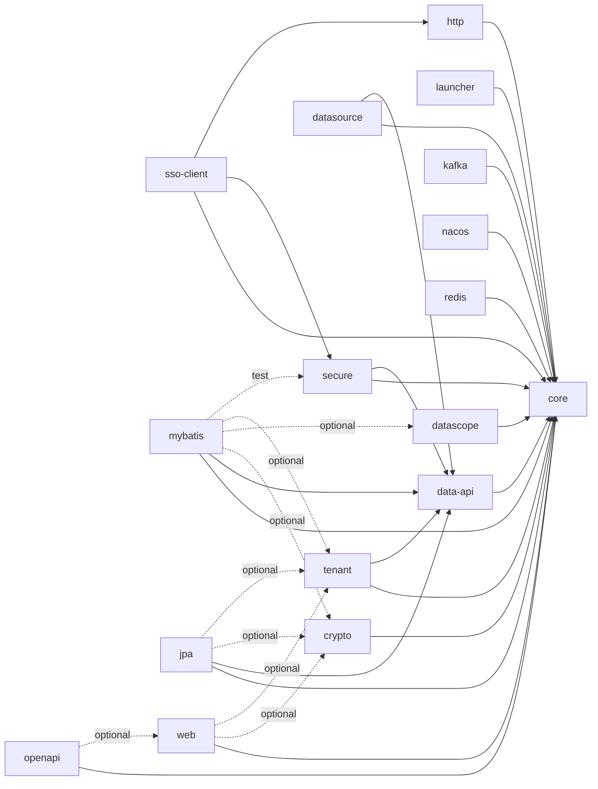

# ZHKJ Framework 架构总览与设计规约

> **适用基准**: OpenJDK 21 (LTS), Spring Boot 4.1.1, Spring Cloud 2025.1.2, Spring Cloud Alibaba 2025.1.0.0（版本以根 `pom.xml` 为准）  
> **文档定位**: 框架总体拓扑、分层职责、模块矩阵、依赖关系与全局架构底线约束  
> **架构设计与创作者**: Jason.Yang（274107098@qq.com）  

---

## 📐 1. 整体分层架构

框架由 17 个框架模块组成（`zhkj-framework-*`），按职责划分为以下层次。各层之间的真实依赖关系以模块 `pom.xml` 为准，见第 3.11 节，**不是严格的线性分层**。

```
┌─────────────────────────────────────────────────────────────────────────┐
│                       应用业务层 (Application Layer)                     │
│                     业务服务 / Controller / Scheduler                   │
└─────────────────────────────────────────────────────────────────────────┘
                                    │
                                    ▼
┌─────────────────────────────────────────────────────────────────────────┐
│                     表现层与通信层 (Web & RPC Layer)                     │
│   ┌───────────────────────────────┬─────────────────────────────────┐   │
│   │ zhkj-framework-starter-web    │ zhkj-framework-starter-http     │   │
│   │ - 统一 R<T> 响应自动封装       │ - Spring 6+ @HttpExchange RPC   │   │
│   │ - 全局异常处理 (GlobalExceptionHandler)│ - 全链路 Header 透传拦截器 │   │
│   │ - XSS 路径规整清洗防护        │ - 全局优雅降级 FallbackFactory  │   │
│   │ - TraceId 分布式链路追踪      │ - 基于 LoadBalancer 的负载均衡   │   │
│   └───────────────────────────────┴─────────────────────────────────┘   │
└─────────────────────────────────────────────────────────────────────────┘
                                    │
                                    ▼
┌─────────────────────────────────────────────────────────────────────────┐
│                    功能起步组件层 (Starters Integration)                 │
│   ┌───────────────────┬───────────────────┬─────────────────────────┐   │
│   │   数据与持久化    │     数据治理      │       安全与中间件      │   │
│   │ starter-mybatis   │ starter-tenant    │ starter-secure          │   │
│   │ starter-jpa       │ starter-datascope │ starter-sso-client      │   │
│   │ starter-datasource│                   │ starter-crypto          │   │
│   │                   │                   │ starter-redis           │   │
│   │                   │                   │ starter-kafka           │   │
│   │                   │                   │ starter-nacos           │   │
│   │                   │                   │ starter-openapi         │   │
│   └───────────────────┴───────────────────┴─────────────────────────┘   │
└─────────────────────────────────────────────────────────────────────────┘
                                    │
                                    ▼
┌─────────────────────────────────────────────────────────────────────────┐
│                       数据抽象层 (Data API Layer)                        │
│   ┌─────────────────────────────────────────────────────────────────┐   │
│   │ zhkj-framework-data-api                                         │   │
│   │ - IAuditEntity / ITenantEntity 等维度契约                       │   │
│   │ - PojoBaseEntity / PojoTenantEntity 纯 POJO 基础实体模型        │   │
│   │ - AuditUserProvider SPI（审计用户提供者）                       │   │
│   └─────────────────────────────────────────────────────────────────┘   │
└─────────────────────────────────────────────────────────────────────────┘
                                    │
                                    ▼
┌─────────────────────────────────────────────────────────────────────────┐
│                       核心基础层 (Core Engine Layer)                     │
│   ┌───────────────────────────────┬─────────────────────────────────┐   │
│   │ zhkj-framework-core           │ zhkj-framework-launcher         │   │
│   │ - 统一 R<T> 响应载体          │ - ZhkjApplication 启动入口      │   │
│   │ - FrameworkContext 上下文门面 │ - 环境探测与启动耗时统计        │   │
│   │ - 展示态脱敏规则 (desensitize)│ - ASCII Banner                  │   │
│   │ - util 包单数工具类           │                                 │   │
│   └───────────────────────────────┴─────────────────────────────────┘   │
└─────────────────────────────────────────────────────────────────────────┘
```

---

## 🧩 2. 模块职责矩阵 (17 个框架模块)

整个框架采用扁平 Starter 组合化设计。根 `pom.xml` 的 `<modules>` 仅列出以下 17 个模块；`samples/` 示例工程不在根 reactor 中，需单独构建（见 `README.md`）。

| 层次 | 模块名 (`artifactId`) | 职责定位 | 核心类与契约（以代码为准） |
| :--- | :--- | :--- | :--- |
| **核心层** | `zhkj-framework-core` | 通用工具箱、协议模型、统一上下文门面、展示态脱敏、盲索引计算 | `api.R`, `context.FrameworkContext`, `context.ContextSnapshot`, `constant.HeaderConstant`, `util.date.DateUtil`, `util.JsonUtil`, `util.DigestUtil`, `util.crypto.BlindIndexUtil` |
| **核心层** | `zhkj-framework-launcher` | 统一微服务/单体引导入口、环境探测、启动耗时统计 | `launch.ZhkjApplication`, `launch.service.LauncherService`, `launch.props.ZhkjProperties` |
| **数据抽象** | `zhkj-framework-data-api` | 框架无关持久化契约、审计模型、审计用户 SPI | `data.model.IAuditEntity`, `ITenantEntity`, `ILogicDeleteEntity`, `IVersionEntity`, `PojoBaseEntity`, `data.spi.AuditUserProvider` |
| **通信层** | `zhkj-framework-starter-http` | 声明式 HTTP 客户端、全链路 Header 透传、降级 | `@EnableHttpClients`, `HttpClientRegistrar`, `HttpClientHeaderInterceptor`, `HttpClientFallbackFactory` |
| **Web层** | `zhkj-framework-starter-web` | 统一响应切面、全局异常处理、XSS 规整防护、TraceId、内部 RPC 脱敏旁路 | `GlobalExceptionHandler`, `ZhkjResponseBodyAdvice`, `XssFilter`, `TraceIdFilter`, `InternalRpcDesensitizeFilter`, `FrameworkContextClearFilter`, `WebUtil` |
| **持久层** | `zhkj-framework-starter-mybatis` | MyBatis-Plus 增强、审计自动填充、国密存储加密与盲索引、租户与数据权限拦截器 | `ZhkjMetaObjectHandler`, `MybatisTenantEntity`, `EncryptTypeHandler`, `MybatisTenantHandler`, `MybatisDataScopeInterceptor`, `ZhkjPaginationInterceptor` |
| **持久层** | `zhkj-framework-starter-jpa` | Hibernate 自动租户过滤（查询及数据库主键加载）、统一有效租户解析、实体写入归属校验、JPA 国密属性转换；不依赖 MVC/OSIV | `JpaTenantAutoConfiguration`, `JpaTenantIdResolver`, `JpaTenantFilterEnabledResolver`, `TenantEntityListener`, `JpaTenantEntity`, `JpaBaseEntity`, `CryptoAttributeConverter` |
| **持久层** | `zhkj-framework-starter-datasource` | 动态多数据源集成（基于 dynamic-datasource）、ShardingSphere 路由支持、事务守卫 | `DynamicDataSourceHelper`, `ZhkjDynamicDataSourceAutoConfiguration`, `DynamicDataSourceTransactionGuardAspect`, `ShardingSphereDynamicRoutingSupport` |
| **数据治理** | `zhkj-framework-starter-tenant` | 多租户上下文、租户解析、租户规则引擎 SPI | `TenantContext`, `TenantRuleProvider`, `TenantResolver`, `HeaderTenantResolver` |
| **数据治理** | `zhkj-framework-starter-datascope` | 数据权限注解、数据范围模型、SQL AST 改写引擎、部门祖先 SPI | `@DataAuth`, `DataScopeModel`, `ScopeModelHandler`, `SqlDataScopeAstEngine`, `DeptAncestorProvider` |
| **安全技术** | `zhkj-framework-starter-secure` | 无状态令牌鉴权、方法级权限、Actuator 安全保护、Token 黑名单 | `SecureUtil`, `@PreAuth`, `ActuatorSecurityConfiguration`, `AuthAspect`, `TokenBlacklistService` |
| **安全技术** | `zhkj-framework-starter-sso-client` | 统一单点登录客户端、OAuth 2.1 授权码换 Token、URI 规整防绕过 | `SsoClientFilter`, `SsoGatewayGlobalFilter`, `SsoContextHolder`, `SsoUserContext` |
| **安全技术** | `zhkj-framework-starter-crypto` | 配置解密 `ENC(...)`、传输报文加解密、存储加密引擎、盲索引注解 | `EncryptablePropertyEnvironmentPostProcessor`, `@EncryptField`, `@BlindIndex`, `StorageCryptoEngine`, `ApiEncrypt`/`ApiDecrypt`, `SM4Util`, `SM2Util`, `SM3Util` |
| **中间件** | `zhkj-framework-starter-redis` | 缓存管理器、声明式分布式锁、Pub/Sub、Key 序列化 | `RedisAutoCacheManager`, `DistributedLockAspect`, `RedisTemplateConfiguration`（`RedisSerializer.json()`） |
| **中间件** | `zhkj-framework-starter-kafka` | 消息收发统一契约 `ZhkjKafka`、上下文与 TraceId 透传、消费端清理 | `ZhkjKafka`, `KafkaContextProducerInterceptor`, `KafkaTraceRecordInterceptor`, `KafkaTraceBatchInterceptor` |
| **中间件** | `zhkj-framework-starter-nacos` | Nacos 服务发现与配置中心接入 | `ZhkjNacosAutoConfiguration` |
| **基础设施** | `zhkj-framework-starter-openapi` | Knife4j 4.5.0 + springdoc OpenAPI 在线接口文档集成 | `OpenApiAutoConfiguration`, `OpenApiProperties`, `OpenApiEnvironmentPostProcessor` |
| **工程根** | `zhkj-framework` | 统一依赖版本与构建插件治理（BOM 与 reactor） | `pom.xml`（`<dependencyManagement>` 纳管框架内部模块与第三方版本） |

---

## 🛡️ 3. 架构设计黄金法则

### 3.1 依赖方向与职责纯粹
1. **依赖关系**: 以各模块 `pom.xml` 为准（见第 3.11 节）。`core` 不依赖任何框架模块，`data-api` 仅依赖 `core`；各 Starter 只依赖其所需的上游模块。严禁循环依赖。
2. **根 POM 依赖洁癖**: 根 POM `<dependencies>` 仅保留编译期增强注解器（`lombok`、`spring-boot-configuration-processor`），不声明任何业务 Starter 或运行时监控包。
3. **依赖版本集中纳管**: 外部依赖版本集中在根 `pom.xml` 的 `<properties>` 与 `<dependencyManagement>`，子模块 POM 未发现字面量版本号。  
   > 已清理: 根 POM 的 `<dependencyManagement>` 与 `<properties>` 中已不存在 `batik`、`xmlgraphics-commons`、`xmlsec`、`xxl-job`、`p6spy` 相关声明或版本属性，无需补齐。

### 3.2 实体多态与持久层解耦
1. **契约抽象**: `zhkj-framework-data-api` 仅提供 `IAuditEntity`、`ITenantEntity`、`ILogicDeleteEntity`、`IVersionEntity` 等契约接口，以及无第三方注解的纯 POJO 基类（`PojoBaseEntity`、`PojoTenantEntity`）。
2. **ORM 专属基类**:
   - MyBatis-Plus 实体继承 `MybatisAuditEntity<ID>`、`MybatisBaseEntity`（特化为 `Long` 主键）、`MybatisTenantEntity` 等；
   - JPA 公共实体继承 `JpaBaseEntity`，租户实体继承直接绑定 `@FilterDef(autoEnabled = true, applyToLoadByKey = true)` / `@Filter` 的 `JpaTenantEntity`；`zhkj.tenant.enabled` 决定隔离及写入校验是否启用，保留应用的 `spring.jpa.open-in-view=false`，不另行注册 MVC 租户过滤链；
   - 底层通用基类不绑定任何持久层注解。

### 3.3 全局上下文生命周期门面 (`FrameworkContext`)
1. **统一门面**: 快照、租户、安全身份、SSO 凭证、数据权限与脱敏开关由 `FrameworkContext`（`core` 模块）统一调度。
2. **显式传递与清理**: 不使用 `InheritableThreadLocal`。跨线程使用 `FrameworkContext.capture()` 获取 `ContextSnapshot`，并通过 `try (ContextScope scope = FrameworkContext.openScope(snapshot))` 或 `FrameworkContext.runWith(snapshot, ...)` 受控执行。
3. **兜底清理**: `FrameworkContext.clearAll()` 依次清理：快照、已注册的 `ContextSnapshotProvider`、`DesensitizeContext`、`SecurityContextHolder`、`TenantContext`、`SsoContextHolder`、`DataScopeContext`，以及通过 `registerCleaner` 注册的自定义清理器。Web 出口由 `FrameworkContextClearFilter`（`Ordered.HIGHEST_PRECEDENCE`）调用该方法；Kafka 消费端在 `KafkaTraceRecordInterceptor` 中调用。

### 3.4 MyBatis-Plus 拦截器链拓扑编排
框架规定的拦截器物理次序为：
$$\mathbf{TenantLineInnerInterceptor} \longrightarrow \mathbf{MybatisDataScopeInterceptor} \longrightarrow \mathbf{Custom} \longrightarrow \mathbf{PaginationInnerInterceptor}$$
- 实现位置: `MybatisPlusConfiguration.mybatisPlusInterceptor(...)` 按上述顺序调用 `addInnerInterceptor`（`zhkj-framework-starter-mybatis/.../config/MybatisPlusConfiguration.java`）。
- `MybatisDataScopeAutoConfiguration` 在检测到 `TenantLineInnerInterceptor` 后，将数据权限拦截器插入到其后一位（`MybatisDataScopeAutoConfiguration.java` 中 `list.add(tenantIndex + 1, ...)`）；分页插件始终置底。

### 3.5 严格工具类单数命名规范
1. **统一标准**: 框架工具类一律采用单数命名，例如 `JsonUtil`、`IdUtil`、`DateUtil`、`StringUtil`、`DigestUtil`、`BeanUtil`、`PropUtil`（位于 `zhkj-framework-core` 的 `io.github.ybb88.framework.util` 包；`DateUtil` 位于 `util.date` 子包）。
2. **零容忍**: 不新建 `*Utils` 复数类。

### 3.6 零业务概念反向渗透 (Zero Business Penetration)
1. **纯粹 SPI 抽象**: 框架源码中未发现业务系统代号（如 `zhkj-ncap`）作为默认值。
2. **契约外置**: 业务定制点（如部门祖先拓扑、加密算法实现、租户规则、审计用户）通过 SPI 接口由上层应用实现并注入，例如 `DeptAncestorProvider`、`CryptoAlgorithmProvider`、`TenantRuleProvider`、`AuditUserProvider`。
3. **存量待治理**: `zhkj-framework-starter-datascope` 的 `DataScopeProperties` 默认值仍为业务表名 `sys_org`、`zhkj_scope_data`、`zhkj_role_scope`（`DataScopeProperties.java` 第 39、64、69 行），与本条及 `GEMINI.md` 的约束不一致。

### 3.7 高频路径 GC 防护与正则预编译
1. **零动态正则编译**: 严禁在 MyBatis 拦截器、动态 SQL 构建或查询主链路中动态拼接并重新编译正则。
2. **静态常量复用**: 正则统一提取为 `private static final Pattern`。示例: `SqlKeyword.SQL_KEYWORD_PATTERN`（`zhkj-framework-starter-mybatis/.../support/SqlKeyword.java:21`）。

### 3.8 工具类架构级防御 (Sealed Utility Defense)
1. **final 与私有构造器**: `*Util` 类应声明为 `public final class` 并提供 `private XxxUtil() {}`。全量扫描结果：除下列存量例外外均满足。  
   > 存量例外: `zhkj-framework-core/.../util/SpringUtil.java:15` 为 `public final class` 但未声明私有构造器，待治理。
2. **常量池类封装**: `StringPool`、`CharPool` 为带私有构造器的 `public final class`（`zhkj-framework-core/.../util/lang/`）。框架内未发现 `public interface *Constant` 形式的常量接口。

### 3.9 行内全限定类名 (Anti-FQCN)
1. **统一导包**: 规约要求依赖在文件头集中 `import`，正文仅使用简单类名。
2. **存量待治理**（初步扫描，未全量核查）:
   - `zhkj-framework-core/.../util/crypto/BlindIndexUtil.java:76`（`java.security.Provider` 行内全限定类名）
   - `zhkj-framework-starter-mybatis/.../config/MybatisPlusConfiguration.java:93`（`com.baomidou.mybatisplus.autoconfigure.MybatisPlusProperties` 行内全限定类名）

### 3.10 内部微服务 RPC 脱敏旁路放行机制
1. **传输标记不是授权**: `X-Internal-RPC: true`（`HeaderConstant.X_INTERNAL_RPC`）仅标记 RPC 调用；普通 RPC 与公共展示端点默认保持 `@Desensitize` 脱敏。
2. **服务端授权契约**: 宿主完成调用方认证与目标内部端点授权后，才可在当前 ServletRequest 设置 `RpcRequestAttribute.DESENSITIZE_AUTHORIZED` 为 `Boolean.TRUE`；不得从 Header 或 ThreadLocal 推断授权。
3. **作用域受控放行**: `InternalRpcDesensitizeFilter` 维持 `Ordered.HIGHEST_PRECEDENCE + 20`，仅认可上述请求属性；授权请求调用 `DesensitizeContext.disable()`，未授权请求显式启用脱敏，`finally` 恢复进入过滤器前的开关状态以支持嵌套调用。授权方在 `finally` 删除请求属性，`FrameworkContextClearFilter` 兜底清理上下文。
4. **宿主接入顺序**: 宿主认证过滤器必须先于 `HIGHEST_PRECEDENCE + 20` 执行，完成调用方认证与目标内部端点授权后，才为确需明文的请求授予脱敏属性；公共展示 API 不因机器凭据正确而获得明文权限。
5. **独立委托与入口清理**: `TENANT_DELEGATION_AUTHORIZED` 标志及可信 JWT 的委托声明均不提供资源/行为级跨租户授权；当前通用委托请求默认拒绝。网关包括匿名路径与 `enabled=false` 分支均剥离 `X-Internal-RPC`、`X-Delegated-Tenant-Id`、`X-Grant-Ticket`，机器认证不等于跨租户授权。

### 3.11 模块依赖拓扑（以各模块 pom 为准）

依赖来源：各 `zhkj-framework-*/pom.xml` 中 `groupId=io.github.ybb88` 的依赖声明。实线为默认依赖，虚线 `optional` 为可选依赖（需调用方自行引入才生效），`test` 为仅测试依赖。



| 模块 | 框架内部依赖（默认） | 可选依赖 (`optional`) | 测试依赖 (`test`) |
| :--- | :--- | :--- | :--- |
| `core` | — | — | — |
| `data-api` | `core` | — | — |
| `launcher` | `core` | — | — |
| `starter-http` | `core` | — | — |
| `starter-kafka` | `core` | — | — |
| `starter-nacos` | `core` | — | — |
| `starter-redis` | `core` | — | — |
| `starter-crypto` | `core` | — | — |
| `starter-datascope` | `core` | — | — |
| `starter-datasource` | `core`, `data-api` | — | — |
| `starter-tenant` | `core`, `data-api` | — | — |
| `starter-secure` | `core`, `data-api` | — | — |
| `starter-sso-client` | `core`, `secure`, `http` | — | — |
| `starter-mybatis` | `core`, `data-api` | `crypto`, `datascope`, `tenant` | `secure` |
| `starter-jpa` | `core`, `data-api` | `crypto`, `tenant` | — |
| `starter-web` | `core` | `crypto`, `tenant` | — |
| `starter-openapi` | `core` | `web` | — |

> 注: `starter-web` 不依赖 `starter-mybatis` 或 `starter-secure`；`starter-web` 自身引入 `spring-boot-starter-web` 与 `spring-boot-starter-actuator`。`starter-sso-client` 面向网关场景，`spring-cloud-starter-gateway-server-webflux` 为可选依赖（`optional`）。

---

## 🧱 4. 示例工程 (`samples/`)

`samples/pom.xml`（parent 为根 POM）包含两个示例模块，不在根 reactor 中：

| 模块 | 用途 | 默认端口 | 要点 |
| :--- | :--- | :--- | :--- |
| `sample-monolith-boot` | 单体示例：MyBatis-Plus + H2 内存库 + 存储加密 | 18080 | `schema.sql` 启动建表；`/sample/users` 提供创建、按 ID 查询、Trace 查询接口 |
| `sample-cloud-service` | 微服务示例：`@EnableHttpClients` 声明式 RPC 客户端 + SSO 客户端依赖 | 18081 | `SampleUserClient` 调用 `http://sample-monolith-boot/sample/users`；`/sample/orders/{orderId}/detail` 聚合数据 |

运行方式见 `README.md` 的「示例工程」一节。
