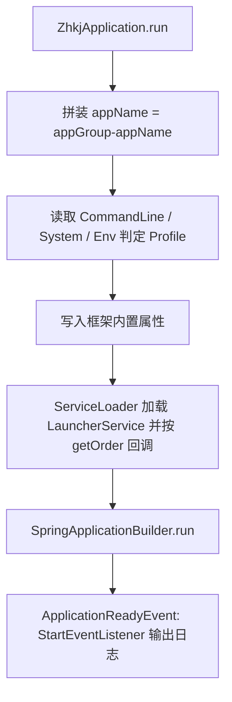

# 应用引导启动模块：zhkj-framework-launcher

> **模块定位**: 统一应用引导启动器，负责组装 `SpringApplicationBuilder`（服务名、环境 Profile、框架属性），提供启动完成日志、服务端口探测、`LauncherService` 扩展 SPI 与集成测试注解。  
> **适用基准**: OpenJDK 21 (LTS), Spring Boot 4.1.1, Spring Cloud 2025.1.2  
> **模块坐标**: `io.github.ybb88:zhkj-framework-launcher`

---

## 📋 1. 架构定位与职责

- **`ZhkjApplication` 门面**: 替代直接调用 `SpringApplication.run`，统一服务名拼装、Profile 判定与框架内置属性注入。
- **Profile 判定**: 从命令行参数、系统属性、系统环境变量中读取 `spring.profiles.active`；未指定时默认 `dev`；激活的 Profile 数量大于 1 时（不限于 `dev` / `test` / `prod`）抛出 `RuntimeException`。
- **扩展 SPI**: `LauncherService` 通过 `ServiceLoader` 加载，按 `getOrder()` 升序回调，可修改 `SpringApplicationBuilder`。
- **自动装配**: `ZhkjLaunchConfiguration` 注册 `ServerInfo` 与 `StartEventListener` 两个 Bean，并启用 `ZhkjProperties`。
- **测试支持**: `@ZhkjBootTest` 组合 `@SpringBootTest` 与 `ZhkjSpringExtension`。

---

## 📦 2. 依赖坐标

```xml
<dependency>
    <groupId>io.github.ybb88</groupId>
    <artifactId>zhkj-framework-launcher</artifactId>
</dependency>
```

依赖（来自 `pom.xml`）: `spring-boot-starter`、`zhkj-framework-core`；`spring-boot-starter-test`、`junit-jupiter`、`lombok`、`spring-boot-configuration-processor` 均为 `optional`。

---

## 🧱 3. 包结构

```
io.github.ybb88.framework.launcher
├── launch/
│   ├── ZhkjApplication.java           # 启动门面 (run / createSpringApplicationBuilder)
│   ├── StartEventListener.java        # ApplicationReadyEvent 日志
│   ├── config/ZhkjLaunchConfiguration.java
│   ├── props/ZhkjProperties.java      # zhkj.* 配置属性
│   ├── server/ServerInfo.java         # 端口、主机名、IP 探测
│   ├── service/LauncherService.java   # 启动扩展 SPI
│   └── util/INetUtil.java             # 主机名、局域网 IP、端口探测工具
├── test/
│   ├── ZhkjBootTest.java              # 集成测试注解
│   ├── ZhkjBootTestException.java    # 缺少 @ZhkjBootTest 时抛出的异常
│   └── ZhkjSpringExtension.java       # JUnit 5 扩展
└── resources/
    ├── banner.txt
    ├── config/bootstrap.yml           # logging.config 指向 log/logback_${zhkj.env:dev}.xml
    ├── log/logback_dev.xml
    ├── log/logback_test.xml
    ├── log/logback_prod.xml
    └── META-INF/spring/org.springframework.boot.autoconfigure.AutoConfiguration.imports
```

---

## ⚙️ 4. 配置项（`zhkj.*`，`ZhkjProperties`）

| 键 | 类型 | 默认值 | 说明 |
| :--- | :--- | :--- | :--- |
| `zhkj.env` | String | — | 环境标识 |
| `zhkj.name` | String | — | 服务名 |
| `zhkj.is-local` | Boolean | `false` | 本地开发标识（启动器运行时会写入 `ZhkjApplication.isLocalDev()` 的结果） |
| `zhkj.base-packages` | String | `com.zhkj` | 业务根包，供其它模块读取 |
| `zhkj.prop.<key>` | Map<String, String> | 空 | 自定义键值，通过 `get` / `getInt` / `getBoolean` / `getDouble` / `containsKey` 读取 |

启动器通过 `SpringApplicationBuilder.properties(...)` 注入以下默认属性（属于 SpringApplication 默认属性，配置文件、环境变量与命令行中的同名键可覆盖）:

| 属性 | 值 |
| :--- | :--- |
| `spring.application.name` | `{appGroup}-{appName}`（`appGroup` 缺省为 `zhkj`） |
| `spring.profiles.active` | 判定后的 Profile（缺省 `dev`） |
| `info.version` | `AppConstant.APPLICATION_VERSION`（当前为 `3.0.0`） |
| `info.desc` | 服务名 |
| `zhkj.env` / `zhkj.name` / `zhkj.group` | Profile、服务名、服务组 |
| `zhkj.is-local` | 是否为非 Linux 操作系统 |
| `zhkj.dev-mode` | Profile 为 `dev` 时为 `true` |
| `zhkj.service.version` | `AppConstant.APPLICATION_VERSION` |
| `spring.main.allow-bean-definition-overriding` | `true` |

`ServerInfo` 读取 `server.port`（默认 `8080`）。

---

## 🧭 5. 启动流程



- `ZhkjApplication.run(String appName, Class source, String... args)`: `appGroup` 缺省为 `zhkj`。
- `ZhkjApplication.run(String appGroup, String appName, Class source, String... args)`: 显式指定服务组。
- `ZhkjApplication.createSpringApplicationBuilder(appGroup, appName, source, args)`: 返回未运行的 `SpringApplicationBuilder`。
- `ZhkjApplication.isLocalDev()`: 操作系统名（`os.name`）非 `LINUX`（大小写不敏感）时返回 `true`；操作系统名为空时返回 `false`。

---

## 🔌 6. 启动扩展 SPI（`LauncherService`）

```java
public interface LauncherService extends Ordered, Comparable<LauncherService> {
    void launcher(SpringApplicationBuilder builder, String appName, String profile);
    @Override default int getOrder() { return Ordered.HIGHEST_PRECEDENCE; }
    @Override default int compareTo(LauncherService o) { return Integer.compare(this.getOrder(), o.getOrder()); }
}
```

实现类需通过 Java SPI 注册，文件路径为 `META-INF/services/io.github.ybb88.framework.launcher.launch.service.LauncherService`（本模块资源目录中未提供该文件）。

```java
package com.example.demo.launch;

import io.github.ybb88.framework.launcher.launch.service.LauncherService;
import org.springframework.boot.builder.SpringApplicationBuilder;

import java.util.Properties;

public class DemoLauncherService implements LauncherService {

    @Override
    public void launcher(SpringApplicationBuilder builder, String appName, String profile) {
        Properties props = new Properties();
        props.setProperty("demo.launcher.enabled", "true");
        builder.properties(props);
    }

    @Override
    public int getOrder() {
        return 10;
    }
}
```

---

## 🧪 7. 集成测试

```java
import io.github.ybb88.framework.launcher.test.ZhkjBootTest;

@ZhkjBootTest(appGroup = "zhkj", appName = "demo-service")
class UserServiceIT {

    @Autowired
    private UserService userService;

    @Test
    void queryUser() {
        assertNotNull(userService.getById(1L));
    }
}
```

`@ZhkjBootTest` 属性: `appGroup`（默认 `zhkj`）、`value` / `appName`（默认 `test`，二者互为别名）。组合注解 `@SpringBootTest(webEnvironment = RANDOM_PORT)` 与 `@ExtendWith(ZhkjSpringExtension.class)`。

> 注意：`ZhkjSpringExtension` 调用 `createSpringApplicationBuilder` 后未使用返回值（`ZhkjSpringExtension.java:23`），因此该扩展构造的 Builder 不会影响测试上下文（代码现状，待确认是否为预期）。若测试类缺少 `@ZhkjBootTest`，`beforeAll` 抛出 `ZhkjBootTestException`。

---

## 📝 8. 启动日志与日志配置

- `StartEventListener` 在 `ApplicationReadyEvent` 时输出 `spring.application.name`（大写）、端口（`local.server.port`，缺省 `8080`）与激活 Profile。该方法标注 `@Async`，需容器中存在异步执行支持（`starter-web` 的 `ZhkjExecutorConfiguration` 提供 `@EnableAsync`）。
- `config/bootstrap.yml` 设置 `logging.config=classpath:log/logback_${zhkj.env:dev}.xml`。`zhkj.env` 由启动器写入，值为 `dev` / `test` / `prod` 时分别选择对应的 logback 文件。`ZhkjApplication` 源码不读取该文件，`zhkj-framework-launcher` 的 pom 未声明 Spring Cloud bootstrap 相关依赖；该文件的实际加载路径 `[待确认]`。
- `banner.txt` 使用 `${spring.application.name}` 与 `${zhkj.env}` 占位符。

---

## 🔗 9. 相关文档

- 配置属性与 Spring 标准项的协作方式见各 Starter 文档。
- 核心工具与常量: [core](./core.md)
